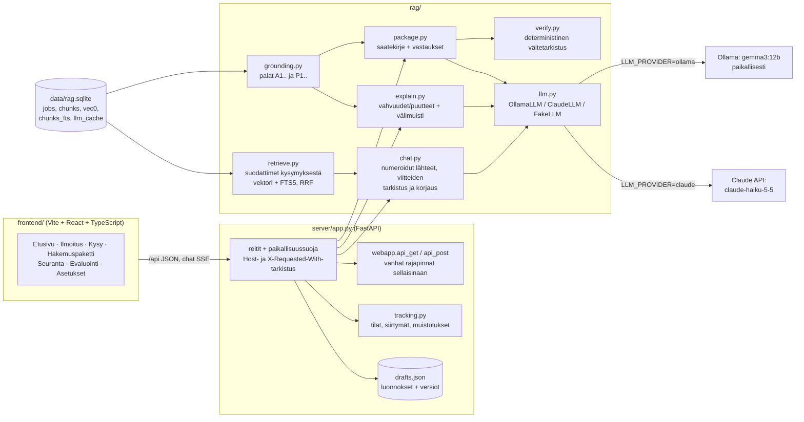
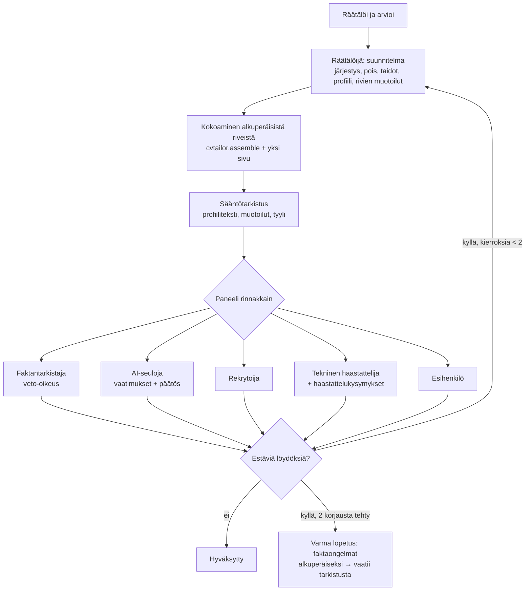
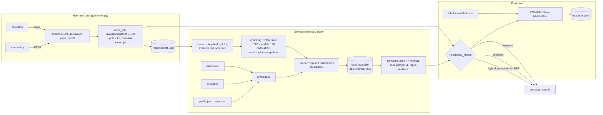

# jobhunter

> **In English:** a personal job search assistant for the Finnish job market. It collects postings
> (Duunitori sitemap, Kuntarekry), ranks them with keyword + semantic (RAG, `BAAI/bge-m3`, sqlite-vec)
> + LLM fit scoring, and evaluates the ranking against hand-labelled data (P@10, NDCG@10). For applying,
> it tailors a one-page CV through a multi-agent review panel (tailor, fact checker with veto, AI-screening
> simulator, recruiter, tech interviewer, hiring manager), writes application answers in the applicant's own
> learned style, and fills portal forms via a browser extension. The core rule is that nothing is invented:
> every claim is checked deterministically against the CV, and unsupported ones are flagged or rejected.
> Python (FastAPI) + React/TypeScript, local models via Ollama or the Claude API. ~200 tests.
> Documentation below is in Finnish.

## Pika-aloitus

```powershell
git clone https://github.com/EliasKarj/jobhunter.git
cd jobhunter
pip install -r requirements-rag.txt
copy .env.example .env               # kielimalli: Ollama (oletus) tai Claude API, ks. alla
mkdir data; notepad data\cv.md       # oma CV Markdownina, otsikot omille riveilleen (## Projektit)
cd frontend; npm install; npm run build; cd ..
python webapp.py                     # http://127.0.0.1:8765
```

**Oma data on yhdessä kansiossa, joka ei ole versionhallinnassa** (`datadir.py`). Oletus on `data/`, ja sen voi siirtää kokonaan repon ulkopuolelle asetuksella `JOBHUNTER_DATA=C:\polku` (ympäristömuuttuja tai `.env`). Kansiossa ovat CV (`cv.md`, `cv_fi.md`), hakuprofiili (`profile.json`), osaaminen (`skills.json`), hakemukset (`applications.json`), räätälöidyt CV:t (`cvs.json`) ja niiden arkisto PDF:ineen (`archive/`), hakemusluonnokset, tyylinäytteet, tulokset ja indeksi (`results/`, `rag.sqlite`), välimuisti (`cache/`), varmuuskopiot (`backups/`), loki ja evaluointimerkinnät (`eval/`). README:ssä mainitut polut, kuten `cvs.json` tai `archive/cv/`, ovat tämän kansion sisällä.

Hakuasetukset kopioidaan ensimmäisellä käynnistyksellä keksityn esimerkkihenkilön profiilista (`examples/profile.json`). Demotila `python webapp.py --demo` käyttää esimerkkihenkilöä (`examples/`: CV, osaaminen, profiili) ja esimerkki-ilmoituksia omassa kansiossaan `demo-data/`, joten omaa dataa ei tarvita eikä se näy. Testit käyttävät aina tyhjää väliaikaista datakansiota.

Henkilökohtainen työnhakutyökalu. Se hakee ilmoitukset Duunitorista ja Kuntarekrystä, pisteyttää ne profiilin
(`profile.json`, `skills.json`) mukaan ja näyttää tulokset selaimessa (`webapp.py`).

**Lähteet:**
- **Duunitori:** koko Suomen ilmoitukset luetaan sivukartasta (`sitemap-jobentry.xml`, noin 80 osaa × 200 ilmoitusta, `search.duunitori_mode: sitemap`). Otsikkosuodatin (`slug_relevant`, ääkköset poistettuina, koska osoitteissa niitä ei ole) päästää läpi noin 27 %. Mitattuna nykyistä aineistoa vastaan läpi pääsi 141/143 vähintään 50 pisteen IT-ilmoituksesta; hylätyt olivat lähinnä CNC-koneistajia, jotka pisteytys oli luokitellut IT:ksi väärin. Ilmoitussivu luetaan vain suodattimen läpäisseistä, ja luettu sivu kelpaa 30 päivää. Päivittäin noin 80 sivukarttapyyntöä ja uusien osumien sivut, kun vanha alueittainen selaus teki noin 350 listasivua ja luki jokaisen uuden ilmoituksen. Vanha tapa: `duunitori_mode: crawl`.
  Aiempi alueittainen laaja haku kävi läpi hakualueiden kaikki ilmoitukset. Hakusanoilla ei haeta: Duunitori ei suodata palvelimella hakusanalla, ja jokainen hakusana palautti samat mainospaikat (tarkistettu 9.11.2026). Hakusanapyynnöt saa takaisin asetuksella `search.duunitori_queries: true`. Huomaa, että Duunitorin robots.txt sallii läpikäynnin vain nimetyille hakukoneille, joten laajaa hakua ei ole laajennettu uusille alueille.
- **Kuntarekry** (kunnat, hyvinvointialueet ja kuntayhtymät koko Suomesta): sivuston oma julkinen hakuosoite palauttaa JSONin (`/fi/tyopaikat/<ammattiluokka>/?format=json`). Oletusluokka on `it-tietohallinto` (`search.kuntarekry_categories`). Yksi pyyntö luokkaa kohden ja sivu jokaisesta ilmoituksesta. robots.txt sallii kaiken.
- **Jobly** on koodissa, mutta se estää automaattiset haut (403).

Avainsanapisteytyksen rinnalla on **semanttinen haku (RAG)**. Ilmoitukset ja oma profiili
(CV, osaaminen, tavoiteroolit) pilkotaan ja embedataan monikielisellä mallilla. Ilmoituksen
semanttinen piste lasketaan palojen samankaltaisuudesta. Lopullinen ranking voi olla avainsana,
semanttinen tai näiden yhdistelmä (hybridi).

Vaiheessa 2 lisättiin generatiiviset ominaisuudet ja uusi käyttöliittymä:

- **chat** ilmoituksista: vastaukset perustuvat haettuihin paloihin, ja jokaisessa väitteessä on lähdeviite
- **sopivuusselitys**: vahvuudet ja puutteet viitteineen sekä ilmoitukseen että CV:hen
- **hakemuspaketti**: saatekirje ja vastaukset portaalikysymyksiin, ja keksityt väitteet liputetaan
- **hakemusseuranta**: tilasiirtymät ja muistutukset

Kaikki toimii ilman API-avainta paikallisella mallilla.

## Käyttöliittymä

`python webapp.py` → http://127.0.0.1:8765. Ajastettu tehtävä (`install_autostart.ps1`) käynnistää saman taustalla.

- **Etusivu.** Rankattu lista, jossa näkyvät pisteet (avainsana, semanttinen, hybridi ja kielimallin sopivuus), suodattimet ja haku. Listassa liikutaan näppäimillä <kbd>j</kbd>/<kbd>k</kbd>.
- **Ilmoitus.** Koko teksti ja sopivuusselitys. Viite [A1] korostaa ilmoituksen kohdan ja [P7] näyttää CV:n tai osaamisprofiilin kohdan. **Räätälöi CV** avaa alkuperäisen ilmoituksen uuteen välilehteen ja tekee CV:n sillä välin.
- **Räätälöity CV.** Paneelin arvio, seulontatulos, yhden sivun sovitus, muokkaus suoraan paperilla ja PDF.
- **Kysy.** Vastaus streamataan. Kysymyksestä päätellyt suodattimet näkyvät siruina, ja viitenumerot avaavat ilmoituksen sivupaneeliin.
- **Seuranta.** Kanban tiloittain sekä listanäkymä ja Mikä toimii -taulukko. Kortin voi raahata tai valita ja painaa numeroa 1–8.
- **Profiili.** Osaaminen, hakuasetukset, vakiovastaukset, projektiskannerin ehdotukset ja oma kirjoitustyyli.

Repossa ei ole kuvakaappauksia omasta datasta. Demotila (`python webapp.py --demo`) käyttää keksittyä esimerkkihenkilöä (`examples/`) ja omaa kansiotaan `demo-data/`, joten kuvat voi ottaa siitä.

**Näppäimet:**

| Näppäin | Toiminto |
|---|---|
| <kbd>j</kbd> / <kbd>k</kbd> | liiku listassa |
| <kbd>Enter</kbd> | avaa |
| <kbd>/</kbd> | haku |
| <kbd>1</kbd>–<kbd>8</kbd> | seurannan tila |
| <kbd>s</kbd> | tallenna |
| <kbd>x</kbd> | piilota |
| <kbd>o</kbd> | alkuperäinen ilmoitus |
| <kbd>e</kbd> | selitys (ilmoitussivulla) |
| <kbd>h</kbd> | räätälöi CV (ilmoitussivulla) |
| <kbd>g</kbd> <kbd>e</kbd> / <kbd>k</kbd> / <kbd>s</kbd> | osastot |
| <kbd>?</kbd> | ohje |

## Arkkitehtuuri: generatiiviset ominaisuudet



| Tiedosto | Tehtävä |
|---|---|
| `rag/llm.py` | Yksi rajapinta, jossa on `stream()`, `complete()` ja `complete_json(schema)`, sekä toteutukset Ollamalle, Claudelle ja testeille. Virheet tulevat ulos `LLMError`-poikkeuksena suomenkielisellä viestillä. |
| `rag/retrieve.py` | Hakee kysymykselle osuvat palat: suodattimet sääntöpohjaisesti, vektorihaku ja sanahaku ilmoitustasolla, ja yhdistäminen RRF:llä. |
| `rag/chat.py` | Muodostaa mallille numeroidut lähteet, streamaa vastauksen ja tarkistaa viitteet. |
| `rag/grounding.py` | Antaa lähdepaloille lyhyet tunnisteet ja muuntaa ne takaisin todellisiksi lähteiksi. Sisältää myös LLM-välimuistin. |
| `rag/explain.py`, `rag/package.py`, `rag/verify.py` | Sopivuusselitys, hakemuspaketti ja väitteiden tarkistus. |
| `rag/bench.py` | Mallivertailu: `python -m rag bench --models a,b`. |
| `server/app.py`, `server/tracking.py`, `server/drafts.py`, `server/envfile.py` | Backend, seurannan logiikka, luonnosten tallennus ja asetusten kirjoitus `.env`-tiedostoon. |

## Ajo-ohjeet: kielimallit

### Paikallinen malli (oletus, ei API-avainta)

```powershell
# Ollama: https://ollama.com (Windows-asennus käynnistää palvelun taustalle)
ollama pull gemma3:12b            # noin 8 Gt, mahtuu 12 Gt:n näytönohjaimeen
pip install -r requirements-rag.txt
# .env: LLM_PROVIDER=ollama ja OLLAMA_MODEL=gemma3:12b (oletukset)
python webapp.py                  # http://127.0.0.1:8765
```

### Claude API

```powershell
pip install anthropic
# .env tai Asetukset-näkymä:
#   LLM_PROVIDER=claude
#   ANTHROPIC_API_KEY=sk-ant-...
#   CLAUDE_MODEL=claude-haiku-5-5
#   CLAUDE_MODEL_WRITING=claude-sonnet-5-5   (valinnainen, vain saatekirjeille)
python webapp.py
```

Claude-providerilla CV ja ilmoitustekstit lähetetään Anthropicille. Paikallisella mallilla kaikki pysyy koneella.

### Komentorivi

Samat toiminnot ilman käyttöliittymää:

```powershell
python -m rag chat "Mitkä Vaasan paikat vaativat Azurea mutta eivät ruotsia?"
python -m rag chat "..." --retrieve-only      # vain haku, ei kielimallia
python -m rag explain <ilmoituksen URL> [--refresh]
python -m rag package <ilmoituksen URL> [--lang fi|en]
python -m rag bench --models gemma3:12b,qwen2.5:latest
```

### Frontendin kehitys

```powershell
cd frontend
npm install
npm run dev        # http://127.0.0.1:5173, /api ohjataan backendiin (8765)
npm run build      # dist/, jonka FastAPI tarjoilee; ilman käännöstä näytetään vanha käyttöliittymä
```

`python webapp.py --legacy` käynnistää vanhan `http.server`-palvelimen ilman uusia ominaisuuksia. Vanha
käyttöliittymä on vielä osoitteessa `/vanha`, mutta kaikki sen toiminnot ovat uudessa käyttöliittymässä:
osaaminen, hakusanat, paikkakunnat ja pisteytyssanastot (Profiili), yritysseuranta (Yritykset) ja käsin lisätyt ilmoitukset (Ilmoitukset → Lisää käsin).

## Valinnat ja perustelut (vaihe 2)

### Kielimallit: gemma3:12b paikallisesti, Claude Haiku 5.5 API:na

Vertailu ajettiin komennolla `python -m rag bench`. Tehtävät olivat samat:

- kaksi chat-kysymystä
- sopivuusselitys
- hakemuspaketti ilmoitukseen, joka vaatii Rustia (Rustia ei ole CV:ssä)

Koneena oli RTX 3060 (12 Gt näytönmuistia) ja i9-10900K. Mallien tekstit ovat tiedostoissa `eval/bench/*.md`.

| Malli | Koko | Chat | Selitys | Hakemus | Arvio |
|---|---|---|---|---|---|
| **gemma3:12b** | 8,2 Gt | Oikeat ilmoitukset viitteineen | Rust tunnistettiin ehdottomaksi puutteeksi, vahvuuksilla lähteet | Noin 270 sanaa sujuvaa suomea. Keksi kerran Rust- ja MQTT-kokemusta, ja tarkistus liputti molemmat | **Valittu** |
| qwen2.5:7b | 4,7 Gt | Vastasi "en löytänyt", vaikka osumia oli, eikä antanut viitteitä | Kelvollinen | Kömpelöä suomea, keksi aloituspäivän | Ei käyttökelpoinen |
| llama3.1:8b | 4,9 Gt | Sekava | Väitti hakijan osaavan Rustia | Saatekirjeeksi tuli pelkkä nimi | Ei käyttökelpoinen |

Suomeen erikoistunutta Poro-2:ta ei testattu. Se on ensimmäinen ehdokas, jos gemman suomi ei riitä.

Oletus on edelleen paikallinen `gemma3:12b`, ja kaikki toimii ilman API-avainta. Omassa käytössäni on kuitenkin `LLM_PROVIDER=claude` ja `SCORE_PROVIDER=claude`, koska Claude Haiku on nopeampi ja lisäosan vastaukset valmistuvat ilman pitkää odotusta. Asetuksen voi vaihtaa `.env`:ssä, ja muutos vaatii palvelimen uudelleenkäynnistyksen.

#### Mitä Claudelle lähtee

| Toiminto | Asetus | Lähtevä sisältö, kun Claude on käytössä |
|---|---|---|
| Sopivuuspisteytys | `SCORE_PROVIDER` | Julkinen ilmoitus ja nimetön tiivistelmä |
| Chat | `LLM_PROVIDER` | Kysymys ja haun löytämät ilmoitukset |
| Sopivuusselitys, lisäosan vastaukset | `LLM_PROVIDER` | Ilmoitus ja profiili: CV:n työ- ja projektikuvaukset, työnantajat mukaan lukien |
| Hakemuspaketti | `LLM_PROVIDER` | Sama kuin yllä sekä hakijan nimi, koska malli allekirjoittaa saatekirjeen |
| CV:n räätälöinti ja käännös | `LLM_PROVIDER` | Ilmoitus ja CV:n sisältö ilman nimeä ja yhteystietorivejä |
| CV:n arviointipaneeli | `LLM_PROVIDER`, `PANEL_MODEL` | Sama kuin räätälöinnissä, ja jokainen arvioija saa ilmoituksen, CV:n rivit ja kootun CV:n |

CV:n nimi ja yhteystiedot lisätään paikallisesti. Sähköpostia ja puhelinnumeroa ei lähetetä missään toiminnossa. Embeddingit, haku, väitetarkistus ja vakiovastaukset pysyvät aina omalla koneella. Tiedot lähtevät Anthropicin API:in, joten arkaluonteista tietoa ei kannata lisätä CV:hen tai profiiliin, jos Claude on käytössä.

Claude-vaihtoehto on halvin malli, `claude-haiku-5-5` ($0,10 / $0,50 per miljoona tokenia). Hinnat:

- chat-kysymys (noin 8 000 tokenia lähteitä ja 500 tokenia vastausta): noin 0,001 $
- hakemuspaketti: noin 0,002 $
- hakemuspaketti Sonnet 5.5:llä (`CLAUDE_MODEL_WRITING`): noin 0,03 $, jos kirjoitusjälkeen haluaa enemmän laatua

### Haku chatille: vektori + FTS5, suodattimet säännöillä

Vaiheen 1 hybridi vertaa ilmoituksia profiiliin. Chatissa vertailukohta on kysymys, joten haku tehdään kahdella tavalla:

- **Vektorihaku (bge-m3)** löytää merkityksen myös kielten välillä: suomenkielinen kysymys löytää englanninkielisen ilmoituksen.
- **SQLite FTS5 -sanahaku** löytää tarkat termit, kuten Azure, PLC tai SAP. Vektorihaku sumentaa niitä. Haku käyttää prefiksejä, joten taivutetut muodot (Azurea, Azuren) osuvat.

Tulokset yhdistetään RRF:llä ilmoitustasolla. Malli saa 8 ilmoitusta ja jokaisesta enintään 3 palaa.

**Suodattimet** päätellään säännöillä eikä kielimallilla, koska säännöt ovat ennustettavia ja testattavia:

- kaupungit indeksin paikkakunnista, myös taivutetut muodot ja astevaihtelu (Helsingissä, Turussa)
- päivämäärät ilmauksista kuten "viime viikolla" tai "3 päivän sisällä"
- lähde

**Kieltoehdot** ("ei ruotsia", "without Java") poistetaan sanahausta. Ilmoituksen pala, jossa kielletty termi mainitaan, otetaan silti kontekstiin, jotta malli voi todeta lähteestä, ettei ehto täyty.

### Viitteet ja keksimisen esto chatissa

1. **Ei relevanttia osumaa:** jos paras kosini jää alle 0,42 eikä sanahaku osu, malli ei saa kysymystä lainkaan. Vastaukseksi tulee suoraan "En löytänyt ilmoituksia…". Lisäksi kehote ohjeistaa mallia sanomaan saman, jos lähteissä ei ole vastausta.
2. **Olemattomat viitteet** poistetaan.
3. **Väärä viitenumero korjataan:** jos rivillä nimetään toisen lähteen otsikko, viite vaihdetaan oikeaan. Pienet mallit sekoittavat numeroita, ja tämä havaittiin ensimmäisessä testissä.
4. **Lainaukset tarkistetaan:** jos lainausta ei löydy viitatusta lähteestä, se liputetaan.
5. **Lauseet ilman viitettä** merkitään käyttöliittymässä aaltoviivalla.

### Hakemuspaketin väitetarkistus: deterministinen

Kehote kieltää keksimisen, mutta pieni malli rikkoo kiellon silti. Testissä se kirjoitti "Olen hankkinut käytännön kokemusta Rust-ohjelmoinnista". Siksi jokainen lause tarkistetaan profiilia ja koko CV:tä vasten säännöillä. Säännöt eivät riipu kielimallin laadusta.

| Tarkistus | Liputetaan, kun |
|---|---|
| Tekniikat ja työkalut | Minä-väitteessä mainittu tekniikka puuttuu profiilista. Sanasto kattaa tunnetut termit sekä lyhenteet, isot kirjaimet sanan sisällä ja symbolit (C#, .NET). Suomen taivutus (DevOpsin) ja yhdyssanat (DevOps-taidot) tunnistetaan. Pidempi termi syrjäyttää osansa: "Azure" ja "DevOps" erikseen eivät todista "Azure DevOps" -työkalua. |
| Luvut ja vuodet | Luku puuttuu lähteistä, esimerkiksi keksityt "3 vuotta". |
| Käsitteet | Suomenkielinen käsite ilman vastinetta profiilissa, esimerkiksi "koneoppiminen". |
| Lähin lähde | Ei liputa. Lauseen ja profiilipalan samankaltaisuus alle 0,55 antaa merkinnän "tarkista". |

Lisäksi:

- **Kiinnostus ei ole osaamisväite.** "Olen valmis oppimaan Rustia" ja "kiinnostunut ERP-järjestelmistä" eivät väitä osaamista, joten niissä ilmoituksen termit sallitaan.
- **Ilmoituksen otsikko ei kelpaa lähteeksi minä-väitteelle.** Otsikko "Rust ja tekoälysovellukset" ei saa todistaa väitettä "osaan Rustia". Virhe löytyi kuvakaappauksia tehtäessä, ja sille on nyt testi.
- **Palkkatoive** on aina `[Täytä itse]`. Mallia ei pyydetä kirjoittamaan sitä.
- **Mitään ei lähetetä mihinkään.**

**Rajoitus:** henkilökuvauksia ("olen järjestelmällinen") ei voi todentaa sanoista. Ne saavat korkeintaan merkinnän "tarkista".

Kielimallipohjaista väitteiden erottelua ei tehty. Se olisi epäluotettava juuri sillä paikallisella mallilla, jonka virheitä sen pitäisi tunnistaa.

### Sopivuusselitys

Malli saa ilmoituksen palat tunnisteilla [A1]… ja profiilin palat tunnisteilla [P1]…. Vastaus tulee JSON-skeeman mukaisena.

- **Vahvuus ilman profiiliviitettä** siirretään piilotettuun listaan "hylätty, ei lähdettä".
- **Viitteet tekstin sisällä:** jos malli kirjoittaa viitteet vain tekstiin, kuten "(A2) … (P5)", ne poimitaan sieltä.

Tulos tallennetaan välimuistiin (`llm_cache`). Välimuistin avaimena on ilmoituksen sisältö, profiili, malli ja kehotteen versio.

Viitteet ovat merkkivälejä `jobs.clean_text`-kenttään, joten käyttöliittymä korostaa täsmälleen oikean kohdan.

### CV:n räätälöinti: valinnat, ei uutta tekstiä

Pieni malli keksi testissä saatekirjeeseen Rust-kokemusta, joten CV:tä se ei saa kirjoittaa (`rag/cvtailor.py`).

1. **Pilkkominen:** `data/cv.md` pilkotaan tunnistetuiksi osiksi. Osiolla on tunniste S2, työpaikalla tai projektilla S2E1 ja luettelon rivillä S2E1B1.
2. **Malli tekee vain valinnat:** osioiden järjestyksen, pois jätettävät kohdat ja korostettavat taidot. Korostettavaksi kelpaa vain taito, joka on CV:ssä. Koulutusta ja kielitaitoa ei jätetä pois, eikä osiota tyhjennetä kokonaan.
3. **Kokoaminen:** koodi kokoaa CV:n alkuperäisestä tekstistä sanasta sanaan. Uutta tekstiä on vain 2–3 lauseen profiiliteksti.
4. **Profiilitekstin tarkistus:** teksti tarkistetaan väitteenä hakijasta. Jos jokin tekniikka, luku tai käsite puuttuu CV:stä, käytetään alkuperäistä profiilitekstiä.
5. **Muokkaus:** käyttöliittymässä voi ottaa kohtia mukaan tai jättää pois ja muokata profiilitekstiä. Palvelin ottaa vastaan vain nämä muutokset, joten CV:n muu teksti ei voi muuttua selaimen kautta.
6. **PDF:** CV tulostetaan selaimen tulostusikkunasta. Tulostusasettelu on A4, ja sovelluksen valikot jäävät pois.

**Suomenkielinen versio:** testissä kone käänsi tutkinnon "Information Technology, Engineering" muotoon "Tieto- ja prosessitekniikka" ja "full-stack" muotoon "täyspinnoitteinen". Siksi käännös tehdään vain kerran:

- Ensimmäisellä kerralla koko CV käännetään rivi kerrallaan. Jokainen rivi tarkistetaan: luvut, tekniikat ja lihavoinnit, ja lisäksi kielten välinen samankaltaisuus bge-m3:lla.
- Tutkintorivit ja ammattinimikkeet merkitään aina tarkistettaviksi.
- Sinä korjaat rivit alkuperäisen rinnalla ja tallennat ne pohjaksi `data/cv_fi.md`.
- Nykyinen pohja käännettiin kerran mallilla `claude-sonnet-5-5`, ja kömpelöt termit korjattiin käsin. Jos `data/cv.md` muuttuu, muutos pitää viedä myös pohjaan.
- Sen jälkeen suomenkieliset CV:t kootaan tästä pohjasta samoin kuin englanninkieliset, eikä mitään enää käännetä.

Räätälöidyt CV:t tallentuvat tiedostoon `cvs.json`.

**Yksi sivu:** `data/cv.md` pysyy täydellisenä pohjana, ja räätälöity CV sovitetaan yhdelle A4-sivulle (`fit_one_page`). Projekteista valitaan enintään viisi ilmoitukseen osuvinta (bge-m3), ja rivejä karsitaan vähiten osuvasta alkaen. Työhistorian nimikkeet, koulutus, taidot ja kielet säilyvät. Esikatselu on A4 millilleen, ja näkymä mittaa todellisen täytön. Oikeista PDF:istä tarkistettuna täyttö oli noin 90 % ja sivuja yksi, myös suomeksi.

### CV:n arviointipaneeli (`rag/panel.py`)

CV-näkymän painike **Räätälöi ja arvioi paneelilla** ajaa räätälöinnin ja viisi arvioijaa. Ajo käynnistyy vain pyynnöstä. Valmis tulos tallennetaan samaan paikkaan kuin tavallinen räätälöinti, joten muokkaus ja PDF toimivat samoin.



- **Räätälöijä ei kirjoita CV:tä vapaasti.** Sen suunnitelma koostuu samoista valinnoista kuin tavallisessa räätälöinnissä. Lisäksi se saa muotoilla yksittäisiä rivejä uudelleen, mutta jokainen muotoilu viittaa yhteen lähderiviin. `cvtailor.check_rewrite` hylkää muotoilun, jos siinä on luku, tekniikka tai väite, jota samassa työpaikassa tai projektissa ei ole. Siksi kahden projektin faktoja ei voi yhdistää. Nimikkeitä, aikoja, koulutusta, kielitaitoa, taitolistaa ja alkuperäistä profiilia ei saa muotoilla.
- **Ei päätelmiäkään** (`rag/claims.py`): luonteenpiirre, johtaminen, tulos, laajuus tai johtopäätös hakijasta ("fast learner", "led", "improved", "production", "demonstrating", "vahva", "johdin", "paransin") hylätään koodissa aina, jos sana tai sen vartalo ei ole lähteessä. Sääntö on `verify.check`issä, joten se koskee profiilitekstiä, rivien muotoiluja, hakemusvastauksia, saatekirjettä ja projektiskannerin luonnoksia. Faktantarkistaja saa lisäksi listan (`NEW_WORDS`) kirjoitettujen kohtien sanoista, joita lähteessä ei ole, ja sen on käytävä jokainen läpi; lähteessä mainitsematon päätelmä on estävä löydös (`inferred`). Kalibrointi: aiemmista 17 kirjoitetusta tekstistä sääntö osui vain yhteen todelliseen lisäykseen ("demonstrating a focus on").
- **Ei tekoälyfraaseja** (`claims.cliches`): fraasit, joista rekrytoija tunnistaa tekoälyn kirjoittaman tekstin ("demonstrating a", "showcasing", "leverage", "seamless", "fast-paced", "intohimoinen", "nykypäivän", pitkä ajatusviiva), hylätään muotoilusta ja liputetaan profiilitekstissä, saatekirjeessä ja vastauksissa, ellei sama fraasi ole hakijan omassa tekstissä. Kalibrointi 766 aiemmalla tekstillä: yksi todellinen osuma. CV:ssä tai sen PDF:ssä ei ole näkyvää tai piilotettua merkintää Claudesta (tarkistettu: ei näkymättömiä merkkejä, ja PDF:n tekijäksi merkitään selain).
- **Faktantarkistaja** saa sääntötarkistuksen tulokset valmiina ja arvioi merkitystä: keksityn, liioitellun, väärän nimikkeen tai päivämäärän sekä eri projektien yhdistämisen. Sen hylkäys estää aina hyväksynnän.
- **Muiden arvioijien** estävä löydös muutetaan ehdotukseksi, jos korjaus vaatisi taidon, jota CV:ssä ei ole. Promptit (`rag/prompts/*.md`) rajaavat estävät löydökset asioihin, jotka räätälöijä voi korjata. Ensimmäisessä testiajossa rekrytoija esti hyväksynnän työhistorian järjestyksellä, eikä ajo päässyt eteenpäin.
- **Varma lopetus:** jos faktantarkistaja hylkää vielä toisen korjauksen jälkeen, sen lainaamat muotoilut ja profiiliteksti korvataan alkuperäisillä, ja tila on *vaatii tarkistusta*. Keksitty sisältö ei päädy lopulliseen CV:hen, eikä ajo jää silmukkaan.
- **Tekoälyseulonta.** Moni työnantaja ja rekrytointipalvelu karsii hakemukset ensin koneellisesti, ja ihminen lukee vain läpi päässeet. Paneeli tarkistaa tämän kahdella tavalla:
  - *Avainsanakattavuus* (`rag/screening.py`, ilman kielimallia): jokaisesta ilmoituksen tekniikasta katsotaan, näkyykö se työ- tai projektirivillä, vain taitolistassa, jäikö se pois sivulta vaikka faktapohjassa on, vai eikö sitä ole lainkaan. Täsmälleen saman tekniikan kirjoitusasut lasketaan samaksi (Postgres = PostgreSQL, JS = JavaScript), ja muotoilu saa käyttää ilmoituksen asua. Korjattavat kohdat menevät räätälöijälle ehdotuksina. Tekniikkaa, jota sinulla ei ole, ei koskaan ehdoteta.
  - *AI-seuloja* (`rag/prompts/ai_screener.md`) simuloi kielimallipohjaista esikarsintaa: poimii ilmoituksen vaatimukset ja eduksi luettavat asiat, merkitsee kunkin tilan (näkyy, heikosti, ei näy vaikka sinulla on, puuttuu sinulta) ja antaa päätöksen *etenee / rajatapaus / karsiutuu*. Estävä löydös on mahdollinen vain, kun korjaus onnistuu oikeilla faktoilla: vaatimus, jonka täytät mutta CV ei näytä, tai profiili, joka ei kytke sinua tehtävään. Puuttuva vaatimus on tieto sinusta, ei CV:n vika, eikä se estä hyväksyntää.
  - *Ei seulojan huijaamista:* tekoälylle osoitettu teksti ("ignore previous instructions", "rank this candidate") hylätään säännöllä sekä profiilista että muotoiluista. Oikeat seulojat tunnistavat tällaisen ja karsivat CV:n.
  - Tulos näkyy CV-näkymässä kohdassa **Tekoälyseulonta**. CV:n rakenne on valmiiksi seulojille sopiva: yksi palsta, tavalliset otsikot, yhteystiedot tekstinä ja PDF tekstinä (selaimen tulostus). PDF:n oletusnimi on *Nimi CV*.
- **Muutoslista** lasketaan koodissa suunnitelmasta. Uudelleenmuotoilut näkyvät ennen ja jälkeen -pareina lähderivin tunnisteen kanssa.
- **Edistyminen:** `POST /api/cv/runs` palauttaa `run_id`:n heti, ja ajo jatkuu taustasäikeessä. Tapahtumat tallennetaan tauluun `run_events`. `GET /api/cv/runs/{id}/events` lähettää ne SSE:nä: `Last-Event-ID` toistaa puuttuvat tapahtumat, ja heartbeat lähtee 15 sekunnin välein. `GET /api/cv/runs/{id}` toimii pollauksena ja vanhan ajon lokina, ja `POST …/cancel` peruuttaa ajon kierrosten välillä. Kesken jääneen kutsun tulos hylätään.
- **Virheet:** API-virheissä tehdään enintään 3 yritystä eksponentiaalisella viiveellä. Skeemaan sopimaton JSON pyydetään kerran korjaamaan. Jos arvioija kaatuu lopullisesti, ajo jatkuu ilman sitä tilassa *vaatii tarkistusta*.

**Asetukset** (`.env`):

| Asetus | Oletus | Merkitys |
|---|---|---|
| `CLAUDE_MODEL_WRITING` | tyhjä = `CLAUDE_MODEL` | Räätälöijän malli |
| `PANEL_MODEL` | tyhjä = `CLAUDE_MODEL` | Arvioijien malli. Faktantarkistaja ajattelee enemmän (`effort=medium`) |
| `PANEL_PRICE_IN`, `PANEL_PRICE_OUT` | 0 | $ miljoonaa tokenia kohden mallin hinnastosta. Arvolla 0 näytetään vain tokenit |

Ollamalla paneeli toimii, mutta arvioijat ajetaan peräkkäin, ja ajo kestää useita minuutteja.

**Mitattu** (`claude-haiku-5-5`, suomenkielinen CV, 2026-11-08):

| Ajo | Kierrokset | Kesto | Tokenit (input + output) | Tulos |
|---|---|---|---|---|
| Ennen promptien tarkennusta | 3 | 211 s (ensimmäinen ajo uudelleenkäynnistyksen jälkeen: embedding-malli latautui) | 137 630 + 27 279 | vaatii tarkistusta: rekrytoija esti järjestyksellä |
| Tarkennuksen jälkeen | 2 | 75 s | noin 108 000 | hyväksytty |
| AI-seuloja mukana (Tieto, junior software engineer) | 2 | 120 s | 140 134 | hyväksytty; seulonta *etenee*, 7/10, avainsanat 82 % |

Yksi kierros kuluttaa noin 50 000 tokenia, ja enimmäismäärä on kolme kierrosta. Hinta riippuu mallin hinnastosta: aseta `PANEL_PRICE_IN` ja `PANEL_PRICE_OUT`, niin hinta näkyy ajon tuloksessa ja ajohistoriassa.

**Prompt caching.** Järjestelmäkehote on kolmessa osassa: (1) ilmoitus, faktapohja ja lisätiedot, jotka ovat samat koko ajon ajan, (2) kierroksen räätälöity CV ja sääntölöydökset, jotka ovat samat kaikille arvioijille, ja (3) agentin oma ohje. Kaksi ensimmäistä osaa merkitään välimuistiin (`cache_control`, 5 min). Ensimmäinen arvioija käynnistetään ensin, ja muut käynnistyvät vasta, kun malli on käsitellyt sen syötteen. Näin ne lukevat välimuistista eivätkä kirjoita kukin omaansa. Välimuisti ei muuta mallin vastausta, koska malli saa täsmälleen saman syötteen.

Mitattu Tiedon ilmoituksella: rekrytoija, esihenkilö ja tekninen haastattelija lukivat 8 700 tokenia välimuistista. AI-seuloja ja räätälöijä kirjoittavat omansa, koska niiden JSON-skeema on eri ja skeema kuuluu välimuistin avaimeen. Säästö on noin 15 % kierrokselta ja enemmän korjauskierroksilla, koska suurin osa hinnasta tulee tulostetokeneista. Hinta-arvio laskee välimuistin kirjoituksen 1,25-kertaisena ja luvun 0,1-kertaisena syötteen hintaan.

### Oma kirjoitustyyli (`rag/stylesamples.py`, `rag/styleprofile.py`)

Profiili → Kirjoitustyyli: kirjoitusmalli tekee luonnoksia keksittyihin harjoitusilmoituksiin, ja käyttäjä muokkaa ne sellaisiksi, jotka lähettäisi itse (`data/style_samples.json`). Parista luonnos → oma versio kirjoitusmalli tiivistää tyyliprofiilin (`data/style_profile.json`), esimerkiksi aikamuodon, aloitukset ja lopetukset, sävyn ja sen, miten yrityksiin viitataan. Profiili ja 1–2 hakijan omaa tekstiä liitetään jokaiseen vastaukseen, vapaamuotoiseen hakemukseen ja saatekirjeeseen. Omat tekstit ovat vain tyylin mallina: faktat tulevat edelleen vain CV:stä, ja profiilin rakennusohje kieltää säännöt, jotka sallisivat osaamisväitteitä, poistaisivat `[Täytä itse]`-kohdat tai kopioisivat kirjoitusvirheitä. Hakijan itse käyttämiä ilmauksia ei liputeta kliseiksi. `profile.json`:n `discreet_names` listaa nimet, joita ei toisteta (esim. toimeksiantajan nimi), ja niiden tilalle kirjoitetaan kuvaus.

### CV:n muokkaus käsin

CV-sivun **Muokkaa**-tilassa kaikki teksti on muokattavissa suoraan paperilla: rivit, projektien ja työpaikkojen otsikot ja aikarivit, otsikkorivit ja profiiliteksti. **+ rivi** lisää rivin projektiin tai osioon, ja valintaruutu jättää kohdan pois. Rakenne (osiot ja tunnisteet) tulee aina tallennetusta versiosta (`drafts.merge_cv_edit`). Muuttuneet rivit merkitään (`edited`, `orig`). Koska teksti on käyttäjän omaa, sitä ei estetä, mutta `cvtailor.check_user_line` liputtaa tekniikat, luvut ja väitteet, joita `cv.md`:ssä tai `cv_fi.md`:ssä ei ole, sekä tekoälyltä kuulostavat fraasit. Liput näkyvät sivupalkin kohdassa Omat muokkaukset. Tallennettu muokkaus arkistoidaan PDF:nä kuten muutkin versiot. Uusi räätälöinti tai paneeliajo korvaa muokkaukset. Osoite `&edit=1` avaa sivun suoraan muokkaustilaan.

### CV-arkisto (`server/archive.py`)

`cvs.json` pitää vain viimeisimmän räätälöidyn CV:n ilmoitusta ja kieltä kohden. Siksi jokainen tallennus (räätälöinti, paneeliajo tai muokkaus) kirjoitetaan myös arkistoon omaksi tiedostokseen yrityksen ja tehtävän mukaan: `archive/cv/<yritys>/<tehtävä>/<aika>_<kieli>.md`, esimerkiksi `archive/cv/Esimerkki Oy/Junior Developer/2026-11-09_141818_fi.md`. Kansioiden nimistä poistetaan Windowsissa kielletyt merkit. Jokaisen version viereen tallentuu myös samanniminen PDF (`server/pdf.py`): koneelle asennettu Chrome tulostaa sovelluksen CV-sivun ilman ikkunaa samoilla tulostustyyleillä kuin itse tulostettaessa (A4, ei ylä- ja alatunnisteita). Tulostus tapahtuu taustalla omalla tyhjällä selainprofiililla (`cache/pdf-profile`), eikä mitään ladata verkosta. Edge ei kelpaa ensisijaiseksi, koska taustalla käynnissä oleva Edge ottaa ajon itselleen. Selaimen voi valita asetuksella `PDF_BROWSER`. Markdown-tiedostossa on CV sellaisena kuin se tulostuu, eli vain mukaan valitut rivit. Samanniminen JSON sisältää kaiken tiedon paneelin arvioineen. Jos sisältö ei ole muuttunut edellisestä versiosta, uutta tiedostoa ei tehdä. Kun hakemus merkitään Seurannassa haetuksi, sen hetkinen versio tallennetaan lisäksi merkinnällä `_HAETTU`, jotta jälkikäteen tiedetään, mikä versio lähti työnantajalle. Kansio `archive/index.json` listaa kaikki versiot. Arkisto on henkilökohtaista dataa, joten se on `.gitignore`ssa.

### Projektiskanneri (`rag/projects.py`)

Skanneri ehdottaa lisäyksiä CV:n projektiosioon omista git-repoista. Se ei koskaan kirjoita CV:tä: ehdotukset tallennetaan tiedostoon `data/project_proposals.json`, ja luettava raportti tulee tiedostoon `results/project_proposals.md`.

```bash
python -m rag projects              # skannaa ja luonnostele uudet projektit
python -m rag projects --no-llm     # vain säännöt, ei kielimallia
python -m rag projects --dismiss ID # piilota ehdotus (pysyy piilossa seuraavissa skannauksissa)
```

Skannaus ajetaan myös automaattisesti haun jälkeen, kun edellisestä on kulunut viikko. Se ajetaan taustalla eikä hidasta hakua.

- **Repot:** kaikki git-repot juurikansiosta (oletus `AABIGBOMBOCLAT`). `secret`, `node_modules`, `.next` ja vastaavat ohitetaan.
- **Tekijyys:** repo otetaan mukaan vain, jos siinä on omia committeja. Omat osoitteet ovat asetustiedoston listassa `own_emails`. Raportti listaa muut commit-osoitteet, joten oman vanhan osoitteen voi lisätä listaan. Ehdotuksessa näkyy omien ja kaikkien committien määrä sekä muut tekijät.
- **Tekniikat** päätellään säännöillä: `package.json`, `requirements.txt`, `pyproject.toml`, Dockerfile, compose-tiedostot, CI-tiedostot, `.csproj` ja tiedostopäätteet. Kieleksi ei lasketa yksittäisiä konfiguraatiotiedostoja.
- **Ehdotustyypit:**
  - *Uusi projekti:* repo, jota CV:ssä ei ole. Kielimalli kirjoittaa siitä 2–3 riviä README:n, omien commit-viestien ja tunnistettujen tekniikoiden perusteella. Jokainen rivi tarkistetaan lähteitä vasten (`verify.check` ja tekniikat), ja lähteistä puuttuva tekniikka liputetaan. Luonnos tehdään uudelleen vain, jos repoon tulee uusia committeja.
  - *Uusi tekniikka:* repossa on tekniikka, jota CV:n vastaavassa kohdassa ei mainita.
  - *Muutoksia:* CV:ssä olevaan projektiin on tullut omia committeja CV:n viimeisen muokkauksen jälkeen.
- **Projektin tunnistus:** CV:n projekti yhdistetään repoon nimen tai `package.json`:n nimen perusteella. Jos nimet eroavat, lisää alias, esimerkiksi `"aliases": {"repo-nimi": "CV:n projektin nimi"}`.

Asetukset ovat tiedostossa `data/projects.json`:

| Avain | Merkitys |
|---|---|
| `own_emails` | Omat commit-osoitteet |
| `aliases` | Repon nimestä CV:n projektin nimeen |
| `ignore` | Ohitettavat repot nimen perusteella |
| `root` | Skannattava kansio (tyhjä = `AABIGBOMBOCLAT`) |
| `llm` | `default` (`LLM_PROVIDER`), `ollama` (README:t ja commit-viestit pysyvät koneella) tai `off` |

**Hyväksyntä käyttöliittymässä (Profiili → Projektit):**

- *Uusi projekti:* nimeä, tekniikkariviä (oletuksena tekniikat ja vuodenaika CV:n tyyliin) ja rivejä voi muokata ennen kuin projekti lisätään. Rivit, joille ei löydy lähdettä, on merkitty, ja lisääminen pyytää vahvistuksen. Projekti lisätään `cv.md`:n projektiosion alkuun.
- *Uusi tekniikka:* valitut tekniikat lisätään CV:n kohdan tekniikkariville.
- *Muutoksia:* commitit näytetään, ja ehdotuksen voi kuitata käsitellyksi.
- Ennen jokaista muutosta `cv.md` kopioidaan kansioon `backups/cv-<aika>.md`. Mitään ei muuteta ilman painallusta.
- Hyväksynnän jälkeen sovellus tarjoaa osaamisprofiiliin ne tekniikat, joita siellä ei vielä ole, ja pisteytys päivittyy.
- **Oma osuus** (`data/project_notes.json`): kuhunkin projektiin voi kirjoittaa esimerkiksi "tehty tekoälyn kanssa opiskeluprojektina". Merkintä ei näy CV:ssä, mutta arviointipaneelin räätälöijä ja arvioijat saavat sen taustatiedoksi.
- Muut commit-osoitteet voi merkitä omiksi yhdellä painalluksella, minkä jälkeen repot skannataan uudelleen.
- **Ilmoitus:** kun skanneri löytää ehdotuksen, jota et ole vielä nähnyt, sivupalkin Profiili-kohtaan tulee lukumäärä ja etusivulle ilmoitus, jossa on linkki Projektit-välilehdelle. Jokainen ehdotus saa löytöhetken (`found`), ja Projektit-välilehden avaaminen tallentaa katseluhetken (`seen_at` tiedostossa `data/projects.json`). Sen jälkeen ilmoitus poistuu, ja edellisen käynnin jälkeen tulleet ehdotukset näkyvät välilehdellä merkinnällä "Uusi".

**Suomenkielinen pohja pysyy ajan tasalla (`rag/cvsync.py`).** Rivien tunnisteet riippuvat paikasta, joten uusi projekti siirtäisi kaikkien sen jälkeisten rivien tunnisteita. Siksi suomennokset muistetaan sisällön mukaan tiedostossa `data/cv_fi_map.json` (englanninkielinen rivi → suomennos). Myös omat muokkauksesi `cv_fi.md`:hen tallentuvat muistiin, kun pohjat ovat samanrakenteiset. Kun `cv.md` muuttuu, Projektit-välilehti näyttää, montako riviä on uusia, ja kääntää vain ne samoilla tarkistuksilla kuin pohjan luonnissa. Sinä tarkistat käännökset, ja pohja kootaan uudelleen `cv.md`:n rakenteella.

Commit-päivät eivät aina kerro työn ajankohtaa. Esimerkiksi monen koulurepon viimeinen commit on 2026-06-14, jolloin repot on ilmeisesti siirretty kerralla. Tarkista aikaväli ennen kuin siirrät sen CV:hen.

### Etäkäyttö puhelimella (Tailscale)

Palvelin kuuntelee vain osoitetta `127.0.0.1`, eikä reitittimeen avata portteja. `tailscale serve` välittää tailnetin HTTPS-osoitteen palvelimelle ja lisää jokaiseen pyyntöön otsikon `Tailscale-User-Login`, joka kertoo tunnistetun Tailscale-käyttäjän.

```powershell
tailscale serve --bg 8765          # https://<kone>.<tailnet>.ts.net -> 127.0.0.1:8765
tailscale serve status
tailscale serve reset              # etäkäyttö pois
```

- **Kuka pääsee:** vain `REMOTE_USERS`-listan Tailscale-käyttäjät ja `REMOTE_HOSTS`-listan osoitteet (`.env`). Tyhjä lista = etäkäyttö estetty. Selain ei voi väärentää otsikkoa toiselta sivustolta, koska se vaatisi CORS-esitarkistuksen, jota palvelin ei hyväksy.
- **Vain koneen ääressä:** kielimalli- ja hakuasetukset (`.env`), API-avain, selainlaajennuksen avain ja laajennuksen rajapinta. Muu sovellus toimii etänä normaalisti, ja muuttavat pyynnöt vaativat edelleen `X-Requested-With`-otsikon.
- **Edellytykset:** tailnetin HTTPS-varmenteet ovat käytössä (Tailscalen hallintapaneeli → DNS → HTTPS Certificates), Tailscale on päällä puhelimessa, ja kone on hereillä.

### Portaalien kysymykset

Hakemuspaketissa on saatekirjeen lisäksi viisi ilmoituskohtaista vastausta: kerro itsestäsi, miksi haet, miksi sinut kannattaa valita, vahvuudet ja mitä haluat kehittää. Ne kulkevat saman väitetarkistuksen läpi.

**Vakiovastaukset** (Profiili → Vakiovastaukset, `answers.json`) ovat tietoja, joita vain käyttäjä tietää: aloituspäivä, palkkatoive, työmuoto, sijainti, ajokortti, työlupa, linkit ja suosittelijat. Kielimalli ei kirjoita eikä muuta niitä. Ne näkyvät jokaisessa hakemuspaketissa kopiointipainikkeen kanssa.

### Selainlaajennus: vastaukset kentän vieressä (`extension/`)

Hakulomakkeella kentän viereen ilmestyy leijuva palkki, jossa on tunnistettu kysymys, ehdotettu vastaus sekä painikkeet Kopioi ja Lisää kenttään.

**Asennus:** `chrome://extensions` → kehittäjätila → Lataa pakkaamaton → kansio `extension`. Avain on kohdassa Asetukset → Selainlaajennus, ja se liitetään palkkiin kerran.

**Käyttö:** avaa lomake ja paina laajennuksen kuvaketta. Palkki arvaa hakemuksen sivun otsikosta ja osoitteesta, ja hakemuksen voi vaihtaa valikosta.

Vastausten lähteet tässä järjestyksessä (`server/assist.py`):

1. **Yhteystiedot CV:stä ja vakiovastaukset.** Kielimalli ei arvaa näitä: tyhjästä vakiovastauksesta tulee ohje täyttää se.
2. **Hakemuspaketti**, jos kysymys vastaa jotakin sen kohtaa.
3. **Kielimalli** avoimiin kysymyksiin. Vastaus kulkee saman tyylikorjauksen ja väitetarkistuksen läpi kuin hakemuspaketti.

**Etukäteishaku:** käynnistettäessä lomakkeen kaikki kysymykset luetaan kerralla. Valmiit vastaukset haetaan heti, ja avoimet kysymykset kirjoitetaan taustalla jonossa, joten vastaus on yleensä valmis, kun kenttään tullaan. Lyhyet kentät (esim. postinumero) eivät mene mallille itsestään, vaan niihin ehdotus pyydetään painikkeesta. Uudet kentät poimitaan, kun portaali vaihtaa näkymää. Vastaukset jäävät välimuistiin.

**Rajaukset:**

- Laajennus käyttää `activeTab`-oikeutta, eli se toimii vain sivulla, jolla kuvaketta painetaan, ja kuvaketta pitää painaa uudelleen sivun latauksen jälkeen.
- Lomaketta ei lähetetä koskaan. Kenttä täytetään vain painikkeesta.
- Kenttiin kirjoitettua tekstiä ei lueta. Sivulta lähtee vain kysymyksen teksti, sivun otsikko ja osoitteen isäntänimi, ja nekin vain omalle koneelle (`127.0.0.1`).
- Rajapinta vaatii laajennusavaimen (`data/extension.key`).
- Toisesta osoitteesta ladatuissa upotuksissa (iframe) palkki ei toimi, koska `activeTab` kattaa vain pääsivun osoitteen.

### Sopivuusarvio kielimallilla (`rag/llmscore.py`)

Hybridi tunnistaa aiheen, mutta ei epäsuoria vaatimuksia ("työvuosia mittarissa", otsikon "Junior" ja tekstin 2–4 vuoden vaatimus). Siksi kielimalli lukee hybridin kärjen (`SCORE_TOP`, oletus 500), merkityt ilmoitukset ja haun uudet kärki-ilmoitukset ja antaa sopivuuspisteen, tason ja yhden lauseen perustelun. Sopivuus on oma sarakkeensa eikä muuta hybridipisteitä. Etusivun oletusjärjestys on hybridin ja sopivuuden keskiarvo, ja listan voi järjestää myös pelkän hybridin tai sopivuuden mukaan.

- **Oma asetus:** `SCORE_PROVIDER=off|ollama|claude` on erillään `LLM_PROVIDER`-valinnasta. Pisteytyksessä Claudelle lähtee vain julkinen ilmoitus ja nimetön tiivistelmä: ei nimeä, yhteystietoja eikä työnantajia. Muut tekstit kulkevat `LLM_PROVIDER`-asetuksen mukaan, ks. [mitä Claudelle lähtee](#mitä-claudelle-lähtee).
- **Välimuisti:** samaa ilmoitusta ei arvioida uudelleen, ellei ilmoitus, tiivistelmä tai malli muutu.
- **Ajo:** `python -m rag llm-score`, ja haun jälkeen automaattisesti.

| 10 ilmoituksen mittaus | `gemma3:12b` | `claude-haiku-5-5` |
|---|---|---|
| Aika per ilmoitus | 7,6 s | 4 s, kuusi rinnakkain 0,6 s |
| 3 780 ilmoitusta | noin 8 h | noin 40 min |
| Ylen avoin haku (vaatii vuosien kokemusta) | 40, taso "junior" | 8, taso "senior" |

Vaatimustason tunnistamiseksi myös avainsanapisteytyksen kokemusrajaan lisättiin pehmeät ilmaisut (`years_cap_terms`, esim. "useamman vuoden" ja "strong experience").

Arvio paransi järjestystä: yhdistelmä nosti kärjen NDCG@10:n hybridin arvosta 0,69 arvoon 0,81 ja erottelun (AUC) arvosta 0,80 arvoon 0,84. Luvut ja varaukset ovat [tuloksissa](#tulokset).

### Luonteva kieli (`rag/style.py`)

Pieni malli kirjoitti aluksi tekstiä, jonka tunnistaa heti tekoälyn kirjoittamaksi. Esimerkiksi: *"A highly motivated… student with a diverse background… complemented by…"* ja *"Olen innostunut…"*. Korjaukset:

1. **Tyyliohje kehotteessa:** teksti on konkreettista (mitä tehtiin, millä ja kenelle), hakijasta ei puhuta kolmannessa persoonassa, ja malliksi annetaan hakijan oma profiiliteksti.
2. **Tunnistus ja uudelleenkirjoitus:** noin 60 tyypillistä fraasia suomeksi ja englanniksi sekä toistuva virkkeen aloitus ("Olen… Olen…") tunnistetaan säännöillä. Jos niitä löytyy, kohta kirjoitetaan kerran uudelleen, ja malli saa palautteeksi löydetyt fraasit. Uudelleenkirjoitus hyväksytään vain, jos siinä on vähemmän fraaseja eikä tietoa katoa. Jäljelle jääneet fraasit näytetään editorissa tyylihuomiona.
3. **Väitetarkistus vasta lopuksi:** tarkistus ajetaan uudelleenkirjoituksen jälkeen, joten uudelleenkirjoituskaan ei voi lisätä keksittyjä väitteitä.

Samalla väitetarkistus tiukentui kahdella tavalla:

- **Ilmoituksen tekniikkalistat:** listojen pienellä kirjoitetut nimet ("Rust, axum, sqlx ja egui") tunnistetaan, ja malli saa listan ilmoituksen vaatimuksista, joita profiilissa ei ole.
- **Oppimiskohteet:** oppimisverbin jälkeen mainitut tekniikat ("valmis oppimaan Rustia") eivät ole osaamisväitteitä.

Mittaus samalla Rust-ilmoituksella:

| | Ennen | Jälkeen |
|---|---|---|
| CV:n profiilitekstin kliseet | 3 ("highly motivated", "diverse background", "complemented by") | 0 |
| Saatekirjeen keksityt osaamisväitteet | Rust, MQTT ja sqlx (sqlx jäi liputtamatta) | 0, ja Rust ja MQTT mainitaan opittavina |

**Kolmas persoona suomeksi.** Räätälöinnin ohjeessa luki aiemmin "ei minä-muotoa", ja malli kirjoitti suomeksi "Rakentaa…" ja "opiskelija, joka valmistuu…". Nyt ohje vaatii minä-muodon ilman minä-sanaa ("Rakennan…", "valmistun…"). `style.third_person_fi` tunnistaa virkkeen alun yksikön 3. persoonan verbin ja hakijaa kuvaavan relatiivilauseen. Jos kolmas persoona jää uudelleenkirjoituksen jälkeenkin, profiiliteksti hylätään kuten keksitty väite, ja CV:hen tulee alkuperäinen profiili. Paneelissa räätälöijä saa tästä sääntölöydöksen.

### Hakemusseuranta

Tilat ovat:

1. Kiinnostava
2. Hakemus työn alla
3. Haettu
4. Haastattelu
5. Tarjous
6. Hylätty
7. Ei vastausta
8. Peruttu (vanhan seurannan tila säilytettiin lisälopputilana)

Sallitut siirtymät on määritelty taulukossa `server/tracking.py`. Esimerkiksi tilasta "Ei vastausta" voi siirtyä tilaan "Haastattelu", koska vastaus voi tulla myöhässä. Edelliseen tilaan voi aina palata. Lopputiloista (Hylätty, Peruttu) ei voi jatkaa.

CV:n räätälöinti, paneeliajo ja hakemuspaketin luonti siirtävät ilmoituksen tilaan "Hakemus työn alla", jolloin se tulee myös selainlaajennuksen hakemuslistaan. Ilmoitussivun pääpainike on Räätälöi CV. Saatekirje (hakemuspaketti) on toissijainen, koska lomakkeen kysymyksiin laajennus kirjoittaa vastaukset sivulla. Haetusta tulee muistutus, jos vastausta ei ole kuulunut 14 päivään.

Data pysyy `applications.json`-tiedostossa, joten vanhat viennit ja varmuuskopiot toimivat.

**Mikä toimii** (`tracking.outcomes`): Seuranta-sivun taulukko ryhmittelee lähetetyt hakemukset sen mukaan, millainen CV ilmoitukselle on tallennettu. Ryhmät ovat paneelin hyväksymä, paneelissa tarkistettavaksi jäänyt, räätälöity ilman paneelia ja ei räätälöityä CV:tä. Kustakin ryhmästä näytetään vastaukset, haastattelut ja paneelin avainsanakattavuuden keskiarvo. Alle 20 hakemuksella taulukko muistuttaa, että erot ovat vielä sattumaa.

### Frontend: FastAPI + Vite + React + TypeScript

Vanhassa käyttöliittymässä oli yksi 1900 rivin HTML-tiedosto. Seitsemällä näkymällä, editorilla, kanbanilla ja streamaavalla chatilla ilman komponentteja ja tyyppejä sen ylläpito olisi vaikeutunut.

- **Yksi prosessi:** FastAPI tarjoilee käännetyn `dist/`-kansion, joten ajossa on edelleen yksi prosessi eikä Nodea tarvita.
- **Vanhat rajapinnat:** ne ajetaan samoilla funktioilla (`webapp.api_get` / `api_post`), joten logiikkaa ei kopioitu.
- **Visuaalinen suunta:** valittiin kahdeksasta luonnoksesta. Rakenne on vasen sivupalkki, sivun yläpalkki, suodatinrivi ja tiheä lista, jossa pisteet ovat omina sarakkeinaan. Paletti on grafiitti ja smaragdinvihreä korostus, ja sama paletti on myös vaaleana. Fontit ovat Geist ja Geist Mono (pisteet, päivät ja näppäimet).
- **Viitteet:** selityksen viitteet korostavat ilmoituksen kohdan, kun niitä klikataan.
- **Ei verkkoriippuvuutta:** fontit on paketoitu mukaan.
- **Teemat:** vaalea ja tumma.
- **Kapea näyttö:** toimii 400 px leveydellä.
- **Liike:** `prefers-reduced-motion` pysäyttää animaatiot.


**Edistyminen kaikissa odotuksissa** (`frontend/src/progress.tsx`):

- Sivun yläreunassa näkyy ohut palkki aina, kun jokin palvelinkutsu kestää yli 0,4 s. Se kattaa tallennukset ja lataukset.
- Kun backend tietää edistymisen, palkki näyttää sen: haun vaiheet ("Luetaan ilmoituksia 120/800", "Arvioidaan sopivuutta 40/500"), projektiskannauksen repot ja paneeliajon kierrokset.
- Yksittäisille kielimallikutsuille (selitys, hakemuspaketti, CV:n räätälöinti, käännös, chat) palkki näyttää aika-arvion, ja raidoitus kertoo, että kyse on arviosta. Arvio on oletuksena eri Claudelle ja paikalliselle mallille, ja toteutuneet kestot tallennetaan selaimeen, joten arvio tarkentuu käytössä. Palkki ei näytä valmista ennen kuin työ on valmis, ja jos kesto ylittää arvion, se kerrotaan.

### Testit (vaihe 2)

`tests/test_generative.py` ja `tests/test_server.py` ajetaan `FakeLLM`:llä ilman verkkoa. Ne kattavat:

- **viitteiden muodostuksen:** viitatut, olemattomat ja viitteettömät lauseet, numeron korjaus ja lainausten tarkistus
- **keksittyjen väitteiden liputuksen:** tekniikka, luku, käsite, Azure DevOps ja otsikkovuoto, sekä sen, että aidot väitteet taivutettuina menevät läpi
- **seurannan tilasiirtymät ja muistutuksen** API:n kautta
- **providerin vaihdon ja virheviestit**
- **suodattimien jäsennyksen**
- **selityksen viitteiden validoinnin ja välimuistin**
- **`.env`-tiedoston kirjoituksen ja paikallisuussuojan**

Testejä on yhteensä 177 (ja yksi `pytest -m live` -testi oikeaa API:a vastaan): lisäksi `tests/test_panel.py` (kierrokset, faktantarkistajan veto, varma lopetus, uudelleenyritykset, peruutus, muotoilusäännöt, SSE:n `Last-Event-ID` ja taustaajo), `tests/test_claims.py` (päätelmäsanat profiilissa ja muotoiluissa, NEW_WORDS faktantarkistajalle), `tests/test_screening.py` (avainsanakattavuus, kirjoitusasujen vastineet, seulojalle osoitetun tekstin hylkäys, puuttuva vaatimus ei estä), `tests/test_remote.py` (Tailscale-käyttäjä, väärä käyttäjä tai osoite, lukitut asetukset), `tests/test_projects.py` (tekniikoiden tunnistus, tekijyys oikeilla git-repoilla, luonnoksen tarkistus, piilotus, välimuisti, hyväksyntä cv.md:hen varmuuskopioineen ja suomennosten säilyminen sisällön mukaan) sekä `tests/test_cvtailor.py` (CV:n pilkkominen, sisältö sanasta sanaan, keksityn profiilitekstin hylkäys, käännöstarkistus, suomenkielinen pohja ja muokkauksen rajaus).

---

## Arkkitehtuuri: semanttinen haku (vaihe 1)



| Tiedosto | Tehtävä |
|---|---|
| `rag/config.py` | asetukset `.env`:stä, indeksin tunniste (`config_id` = malli + palakoko + päällekkäisyys) |
| `rag/clean.py` | tekstin siivous, kielentunnistus, `job_id` |
| `rag/chunking.py` | pilkkominen merkkiväleineen |
| `rag/embed.py` | `LocalEmbedder` (sentence-transformers), `OpenAIEmbedder` (urllib), `FakeEmbedder` (testit) |
| `rag/store.py` | SQLite + sqlite-vec: metadata, palat, vektorit, profiilivektorien välimuisti |
| `rag/ingest.py` | ingestion, duplikaattien esto ja karsinta |
| `rag/profile.py` | profiilipalat CV:stä, osaamisesta ja tavoiteroolista |
| `rag/semantic.py` | samankaltaisuus ja aggregointi |
| `rag/hybrid.py` | normalisointi ja yhdistäminen |
| `rag/scoring.py` | kytkentä nykyiseen pisteytykseen (`apply_mode`) |
| `rag/label.py`, `rag/evaluate.py` | merkinnät ja evaluointi |

Nykyiseen koodiin tehtiin vain pienet kytkennät:

- `webapp.py`: `save_rows()` ja `rescore()` kutsuvat `ranked()`-funktiota. Haun jälkeen ajetaan `update_semantic_index()`.
- `jobhunter.py`: uusi lippu `--mode`.

Kun `SCORING_MODE=keyword` (oletus), tulokset ovat täsmälleen samat kuin ennen, eikä torchia tai mallia ladata.

## Valinnat ja perustelut (vaihe 1)

### Vektorikanta: sqlite-vec (ei Chroma)

- **Kevyt.** sqlite-vec on yksi laajennus Pythonin omaan `sqlite3`:een. Projekti käyttää muuten
  lähes pelkkää standardikirjastoa. Chroma toisi kymmeniä riippuvuuksia (onnxruntime, grpc, fastapi…).
- **Duplikaattien esto on yksinkertaista.** Pääavaimet, `ON CONFLICT` ja transaktiot riittävät
  idempotenttiin päivitykseen, ja sen voi testata suoraan SQL:llä.
- **Kaikki samassa tiedostossa.** Metadata, lähdeviitteet ja tulevan chatin tai selitysten tarvitsemat
  tiedot ovat tavallisia tauluja, joita voi yhdistää vektoreihin join-kyselyillä.
- **Mittakaava riittää.** Noin 4000 ilmoitusta ja noin 15 000 palaa. Brute-force-KNN ja numpy riittävät.
- **Riski:** sqlite-vec on versiossa 0.1.x. Vektorit voi tarvittaessa siirtää BLOB-kenttään, eikä rajapinta muutu.

### Embedding-malli: BAAI/bge-m3 paikallisesti

| Vaihtoehto | Tyyppi | Koko / hinta | Huomiot |
|---|---|---|---|
| **BAAI/bge-m3** (valittu) | paikallinen | 568M parametria, ~2,3 Gt, 1024 ulottuvuutta, 8192 tokenia | Vahva suomessa (MIRACL-fi), toimii kielten välillä fi↔en |
| intfloat/multilingual-e5-large / -small | paikallinen | ~2,2 Gt / ~470 Mt, 1024 / 384 ulottuvuutta, 512 tokenia | Hyvä; `query:`/`passage:`-etuliitteet hoidetaan automaattisesti |
| OpenAI text-embedding-3-small / -large | API | ~$0,02 / ~$0,13 per 1M tokenia | Koko korpus noin 5M tokenia, eli ensimmäinen ajo maksaa 0,1–0,65 $ |

Raha ei siis ratkaise valintaa. **bge-m3 valittiin, koska CV pysyy omalla koneella**, API-avainta ei
tarvita, malli on suomessa vahva ja se löytää englanninkielisen ilmoituksen suomenkielisellä
profiililla ja päinvastoin. Hinta maksetaan CPU-aikana: ensimmäinen ajo kestää kauan, ja sen jälkeen
embedataan vain uudet ilmoitukset. Mallia voi vaihtaa `.env`:stä, ja jokaisella mallilla on oma indeksinsä.

### Pilkkominen: 1000 merkkiä, 150 merkkiä päällekkäin

- Ilmoitukset jakautuvat osioihin: yritysesittely, tehtävät, "edellytämme" ja "tarjoamme".
  Noin 1000 merkin pala (250–300 tokenia) on suunnilleen yhden osion kokoinen. Vaatimukset
  pysyvät silloin erillään yleisestä yritysesittelystä, eikä osuva signaali laimene.
- Koko ilmoitus yhtenä vektorina laimentaisi signaalin keskiarvoksi. Lauseen kokoiset palat
  menettävät kontekstin ja tuottavat satunnaisia max-osumia.
- Teksti jaetaan ensin riveihin (JSON-LD-kuvauksessa kappaleet ja luettelokohdat ovat omilla riveillään),
  liian pitkät rivit lauseisiin ja lopuksi sanarajoilta.
- Päällekkäisyys tehdään kokonaisina riveinä (enintään 150 merkkiä), jotta vaatimuslista ei katkea kesken kohdan.
- Jokaisen palan alkuun lisätään otsake "otsikko | yritys | kaupunki", jotta irrallinenkin pala kantaa kontekstin.
  Lisäksi tehdään erillinen otsikkopala.
- Mediaani-ilmoituksesta (~3100 merkkiä) tulee noin 4–5 palaa, ja pala mahtuu e5-mallin 512 tokenin rajaan.
- Koko ja päällekkäisyys ovat asetuksia (`--chunk-size`, `--overlap`). Kokeile evaluoinnilla esimerkiksi 500, 1000 ja 1500.

### Siivous

Poistetaan jobhunterin lisäämä "Hakuaika umpeutuu" -rivi, URL-osoitteet, sähköpostit ja
puhelinnumerot (yhteystiedot ovat semanttista kohinaa) sekä toistuvat pitkät rivit. Kieli
(fi/en) tunnistetaan stopsanoilla ja tallennetaan metadataksi.

### Duplikaattien esto ja karsinta

- `job_id` = lähde + URL:n lopussa oleva ilmoitusnumero, esimerkiksi `duunitori:20698022`.
- `content_hash` = otsikon, yrityksen ja siivotun tekstin tiiviste. Jos se on ennallaan, ilmoitus
  ohitetaan eikä mitään embedata. Jos se muuttuu, vanhat palat ja vektorit poistetaan ja ilmoitus embedataan uudelleen.
- Ennen embeddausta etsitään sama palateksti samasta indeksistä. Sama ilmoitus viidessä kaupungissa
  (eri URL) embedataan siis vain kerran.
- Jokaisella `config_id`:llä (malli, palakoko, päällekkäisyys) on oma vec0-taulunsa, joten eri asetuksia voi verrata rinnakkain.
- `prune` poistaa ilmoitukset, joiden hakuaika on mennyt tai joita ei ole näkynyt haussa `PRUNE_DAYS`
  päivään. Tallennetut, haetut ja evaluointiin merkityt ilmoitukset säilytetään.
- Poissuljettuja ja vanhentuneita ilmoituksia ei embedata ollenkaan.

### Profiili ja aggregointi

Profiilipalat:

- **CV** (`data/cv.md`, `.txt` tai `.pdf`): osioittain otsikoiden mukaan. Nimi- ja yhteystieto-osiot ohitetaan.
  Alan ulkopuolinen työkokemus jätetään pois asetuksella `CV_SKIP_SECTIONS` (otsikon osat ;-eroteltuina).
  Muuten esimerkiksi myyjän ilmoitus osuisi vahvasti myyntitaustaan, ja top-k-aggregointi nostaisi sen semanttisen pisteen korkeaksi.
  Osiot säilyvät CV:ssä myöhempiä hakemusluonnoksia varten.
- **Osaaminen** (`skills.json`): yksi pala kategoriaa kohden tasoineen. Mukana ovat myös OPS:sta hyväksytyt taidot.
- **Tavoiteroolit** (`profile.json`:n hakusanat): ainoa tapa tuoda tasotoive (harjoittelija/junior) semanttiseen vertailuun.

Jokaisella palalla on `source_ref`, esimerkiksi `cv.md#Projektit` tai `skills.json#Työkalut ja DevOps`.
Profiilivektorit tallennetaan välimuistiin, joten malli ladataan vain, kun profiili muuttuu.

Pisteen laskenta: ensin otetaan **kunkin profiilipalan paras osuma ilmoituksen paloista (max)**, ja
niistä **k parhaan keskiarvo (top-k mean, k=3)**.

- Pelkkä max palkitsee yksittäisen sattumaosuman, esimerkiksi yleisen "tiimityö"-kappaleen.
- Kaikkien profiilipalojen keskiarvo rankaisee ilmoitusta siitä, ettei se kata koko profiilia, eikä mikään ilmoitus kata.
- Top-k mittaa, kuinka monta profiilin osa-aluetta ilmoitus koskettaa vahvasti.

`AGGREGATION=max|topk_mean|mean` ja `AGG_K` ovat asetuksia, joten vaihtoehtoja voi verrata evaluoinnilla.

### Hybridi

- Kosinit pakkautuvat kapealle välille. Siksi semanttinen piste skaalataan 0–100:aan korpuksen
  p5–max-välin mukaan (alin 5 % leikataan nollaan). Yläpäätä ei leikata p95:een, koska se antoi
  noin 190 ilmoitukselle tasapisteen 100 ja hävitti järjestyksen kärjestä. Avainsanapiste on valmiiksi 0–100.
- `HYBRID_METHOD=weighted`: `(W_KEYWORD·avainsana + W_SEMANTIC·semanttinen) / (W_KEYWORD + W_SEMANTIC)`.
- `HYBRID_METHOD=rrf`: reciprocal rank fusion, painotettuna samoilla painoilla.
- Kovat säännöt pysyvät: poissuljetut ja vanhentuneet ilmoitukset eivät nouse missään tilassa.
  Kattorajat (senior 40, ei-IT 15) koskevat avainsanaosuutta.
- Ilmoitus, jota ei ole vielä indeksissä, saa avainsanapisteensä. Perusteluihin lisätään siitä maininta.

### Tietomalli tulevia ominaisuuksia varten

Chatin, sopivuusselitysten ja hakemusluonnosten tarvitsemat tiedot ovat jo tallessa:

- `jobs.clean_text` sekä palojen `char_start`/`char_end`: tarkka lähdeviite ilmoituksen kohtaan.
- `jobs`-taulun metadata: otsikko, yritys, kaupunki, paikkakunnat, julkaisu- ja hakuaika, kieli, lähde, URL ja id.
- `profile_vectors.source_ref`: mistä CV:n tai osaamisen kohdasta profiilipala on peräisin.
- `Store.knn()`: lähimmät palat kyselylle, eli valmis haku chattia varten.

## Ajo-ohjeet: semanttinen indeksi

```powershell
# 1. Riippuvuudet (CPU-torch ensin, jottei CUDA-versiota ladata turhaan)
pip install torch --index-url https://download.pytorch.org/whl/cpu
pip install -r requirements-rag.txt

# 2. Asetukset
copy .env.example .env          # muokkaa tarvittaessa
# CV tekstinä (otsikot omille riveilleen, esim. "## Projektit"): data\cv.md

# 3. Indeksi nykyisistä hakutuloksista (ensimmäinen ajo ~2,5-3 h CPU:lla, ks. Suorituskyky;
#    keskeytys ei hukkaa tehtyä, uusi ajo jatkaa siitä mihin jäätiin)
python -m rag ingest
python -m rag profile           # tarkista profiilipalat
python -m rag search "junior React-kehittäjä Vaasa"

# 4. Rankingit rinnakkain
python -m rag rank --mode keyword --top 20
python -m rag rank --mode semantic --top 20
python -m rag rank --mode hybrid --top 20

# 5. Käyttöön webappissa: .env -> SCORING_MODE=hybrid
python webapp.py                # haun jälkeen uudet ilmoitukset embedataan automaattisesti

# Pelkkä avainsanapisteytys vertailua varten (riippumatta .env:stä)
python jobhunter.py --mode keyword score jobs.json

# Testit
python -m pytest tests
```

Ensimmäisessä ajossa malli ladataan Hugging Facesta (~2,3 Gt). Mittaus tällä koneella (CPU) on
alla kohdassa *Suorituskyky*.

## Evaluointi

```powershell
# Merkitse 30-50 ilmoitusta (2 = erittäin, 1 = relevantti, 0 = ei; s = ohita, q = lopeta)
python -m rag label --import-state   # valinnainen: webappin tallennetut = 1, piilotetut = 0
python -m rag label -n 40

# Vertaile kolmea rankingia; ajo tallentuu tiedostoon eval/runs.jsonl
python -m rag evaluate --note "perus"
python -m rag evaluate --sweep --note "painot"          # W_SEMANTIC 0...1
python -m rag --agg max evaluate --note "agg max"
python -m rag --method rrf evaluate --note "rrf"

# Eri palakoko tai malli: indeksi ensin (--only-labeled on nopea, embeddaa vain merkityt)
python -m rag --chunk-size 500 --overlap 100 ingest --only-labeled
python -m rag --chunk-size 500 --overlap 100 evaluate --note "c500"

python -m rag runs                   # kaikki ajot taulukkona
```

- **Mistä merkittävät tulevat.** Kunkin rankingin (myös kielimallin) top-15 ja 10 satunnaista ilmoitusta, sekoitettuna,
  joten arvioit tietämättä, mikä ranking ilmoituksen nosti. Pelkän avainsanakärjen merkitseminen suosisi avainsanahakua.
- **pool-luvut (P@10, NDCG@10).** Vain merkityt ilmoitukset järjestetään. Tämä on pääluku.
  Mukana on 95 %:n bootstrap-väli, koska 30–50 merkinnällä muutaman pisteen ero on kohinaa.
- **koko-luvut.** Koko korpus järjestetään, ja merkitsemättömät lasketaan ei-relevanteiksi.
  *Kattavuus* kertoo, montako top-10:stä on ylipäätään merkitty. Matala kattavuus tarkoittaa, että luku on alakanttiin.
- `--only-labeled`-indeksissä semanttisen pisteen normalisointi lasketaan vain merkityistä. Vertaa siis
  sellaisia ajoja keskenään, ei täyden indeksin ajoihin.
- Merkinnät ovat tiedostossa `eval/labels.csv`, ja sitä voi muokata myös Excelissä.

### Tulokset

Ajo 2026-11-04. Asetukset: indeksi `local_bge_m3_c1000_o150`, aggregointi `topk_mean@3`, hybridi `weighted` 0,5/0,5.
Merkinnät tehtiin ilmoituksen koko tekstillä, ja pääasiallinen hylkäysperuste oli kova työkokemus- tai senior-vaatimus.
Tiedostossa on 89 merkintää (18 × 2, 35 × 1, 36 × 0). Niistä 83 on nykyisissä tuloksissa, ja 48 niistä on relevantteja.
Suluissa on bootstrap-95 %-väli. Merkityt-näkymä käyttää vain merkittyjä ilmoituksia. Kattavuus kertoo, kuinka suuri osa koko korpuksen top-10:stä on merkitty.
AUC kertoo, kuinka hyvin piste erottaa relevantit (≥ 1) ei-relevanteista koko merkityssä joukossa.

| Ranking | P@10 | NDCG@10 | AUC | Koko korpus NDCG@10 | Kattavuus |
|---|---|---|---|---|---|
| avainsana | 1,00 | 0,66 (0,43–0,89) | – | 0,55 | 80 % |
| semanttinen | 0,70 | 0,31 (0,12–0,54) | – | 0,31 | 100 % |
| hybridi 0,5/0,5 | 1,00 | 0,69 (0,43–0,90) | 0,80 | 0,61 | 90 % |
| kielimalli (sopivuus) | 0,90 | **0,91 (0,53–1,00)** | 0,72 | 0,52 | 70 % |
| **yhdistelmä (oletus)** | 0,90 | 0,81 (0,53–1,00) | **0,84** | **0,67** | 80 % |

Yhdistelmä on hybridin ja sopivuuden keskiarvo (`COMBINED_FIT_WEIGHT = 0.5`). Jos ilmoituksella ei ole sopivuusarviota, sen sopivuudeksi lasketaan 0.
Aiempi hybridin NDCG 1,00 johtui vanhoista merkinnöistä, jotka oli tehty lyhennetyn tekstin perusteella. Vaatimukset ovat usein ilmoituksen lopussa.

Hybridin painovertailu (NDCG@10, merkityt-näkymä):

| W_SEMANTIC | 0 | 0,1 | 0,2 | 0,3 | 0,4 | 0,5 | 0,6 | 0,7 | 0,8 | 0,9 | 1,0 |
|---|---|---|---|---|---|---|---|---|---|---|---|
| NDCG@10 | 0,66 | 0,66 | **0,71** | **0,71** | **0,71** | 0,69 | 0,62 | 0,51 | 0,46 | 0,37 | 0,31 |

Sopivuuden painon vertailu. Ero pelkkään sopivuuteen on pareittainen bootstrap samoista otoksista:

| Sopivuuden paino | NDCG@10 | AUC | NDCG-ero sopivuuteen | AUC-ero sopivuuteen |
|---|---|---|---|---|
| 0 (hybridi) | 0,69 | 0,80 | −0,17 (−0,47…+0,15) | +0,08 (−0,06…+0,22) |
| 0,3 | 0,79 | 0,84 | −0,08 (−0,34…+0,20) | +0,12 (+0,02…+0,22) |
| **0,5** | 0,81 | 0,84 | −0,04 (−0,21…+0,15) | +0,12 (+0,04…+0,20) |
| 0,6 | 0,83 | 0,82 | 0,00 (−0,13…+0,15) | +0,10 (+0,04…+0,17) |
| 0,8 | 0,87 | 0,79 | +0,02 (−0,08…+0,16) | +0,07 (+0,03…+0,11) |

Tulkinta:

- Pelkkä semanttinen ranking on heikoin, koska embedding ei erota tasoa. Se nostaa kärkeen teknisesti osuvia Senior- ja Lead-tehtäviä.
- Sopivuus lukee epäsuorat kokemusvaatimukset, mutta on käyttäjää tiukempi: 2-merkittyjen keskiarvo on 41 ja pienin piste 10.
  Hybridi tuo mukaan sen, onko ilmoitus ylipäätään oikealta alalta.
- Yhdistelmä on oletus, koska sen erottelu on selvästi sopivuutta parempi, eikä kärjen ero sopivuuteen eroa kohinasta.
  Se on myös paras koko korpuksen top-10:ssä. Paino 0,5 valittiin ensimmäisten 53 merkinnän perusteella, ja se piti 30 uudella merkinnällä.
- Painoja 0,5–0,8 ei voi erottaa toisistaan. Valinta on tasapaino kärjen ja erottelun välillä, ei tarkka optimi.
- Uudet merkinnät tulivat tarkoituksella vaikeista kärki-ilmoituksista, joten luvut eivät ole suoraan verrattavissa aiempiin ajoihin.

### Suorituskyky

Testiajo: bge-m3 CPU:lla, 60 ilmoitusta (30 IT-alan ja 30 muuta), oletusasetukset.

| Mittari | Tulos |
|---|---|
| Mallin ensimmäinen lataus (sisältää ~2,2 Gt:n latauksen) | 80 s |
| Paloja per ilmoitus | 7,2 (433 palaa 60 ilmoituksesta, otsikkopala mukana) |
| Embeddausnopeus | 2,8 palaa/s, eli noin 2,6 s per ilmoitus |
| Uusintaajo, sama data | 0,06 s, 0 embeddausta |
| **Arvio koko korpukselle** (~3800 ilmoitusta) | **noin 2,5–3 h kertaalleen**. Sen jälkeen päivän uudet ilmoitukset (~100–300) vievät noin 5–15 min. |

Jos ensimmäinen indeksointi on liian hidas, `--model intfloat/multilingual-e5-small` on arviolta
5–10 kertaa nopeampi. Laadun voi verrata `evaluate`-komennolla.

**Havainto testiajosta:** semanttinen piste erottaa IT-ilmoitukset muista selvästi (IT-ilmoitukset 0,59–0,63,
myyjä- ja johtotehtävät 0,46–0,49). Se ei kuitenkaan tunnista senioriteettia: "Senior Full-Stack Developer"
oli otoksen kärjessä. Tasoa hoitavat edelleen avainsanapisteytyksen kattorajat ja tavoiteroolipala,
joten pelkän semanttisen rankingin odotetaan häviävän hybridille.
