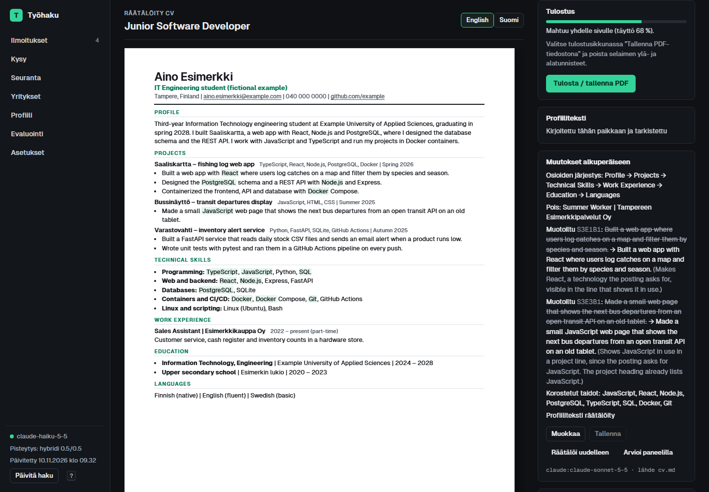
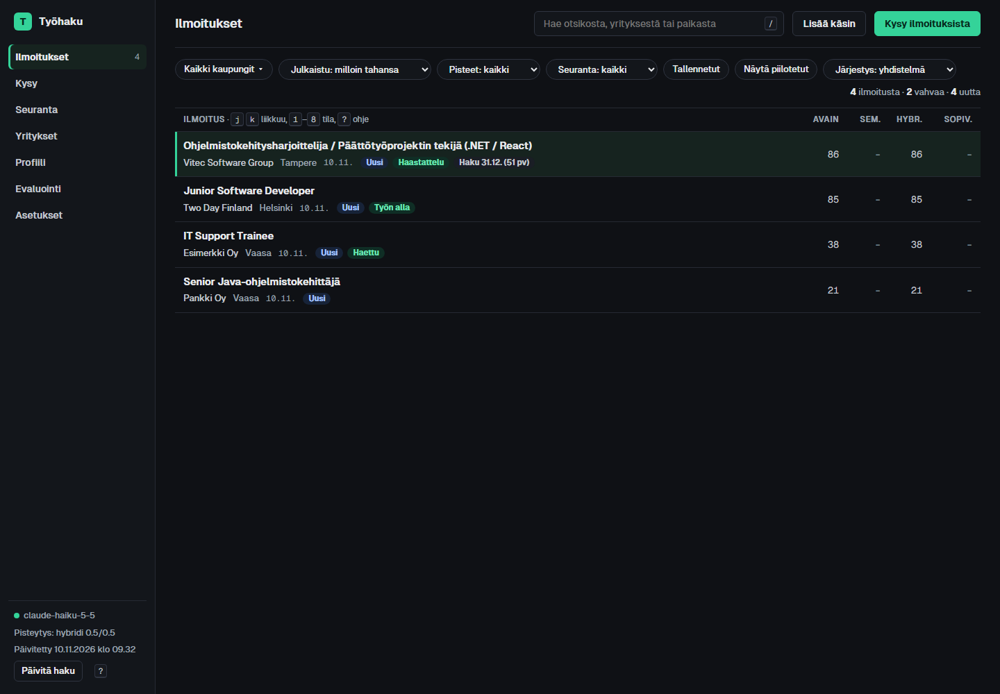
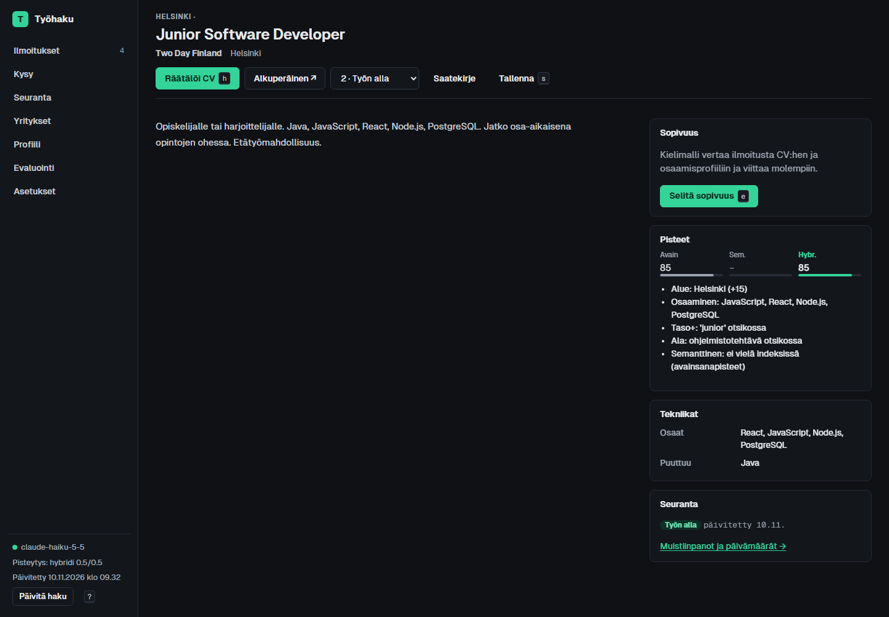
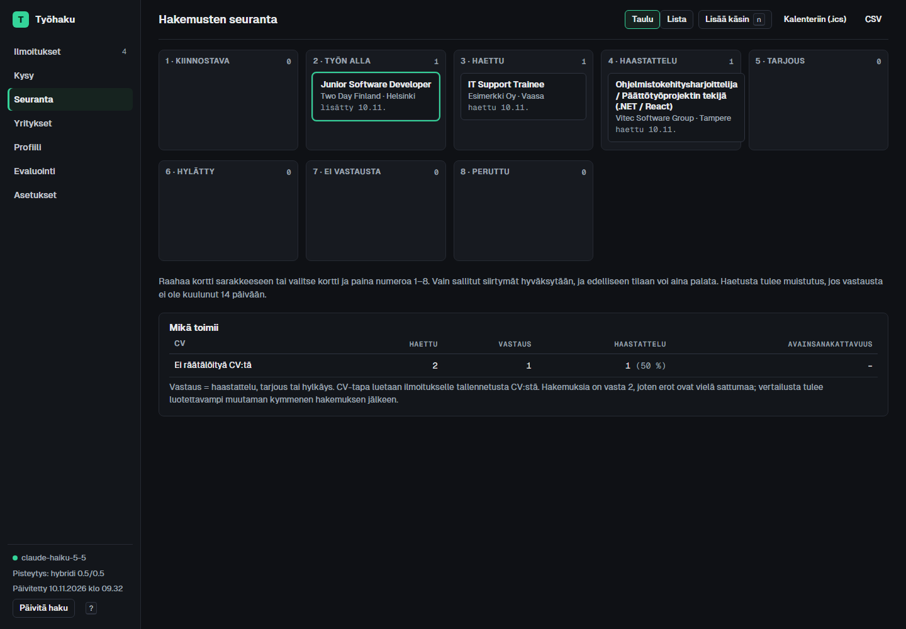
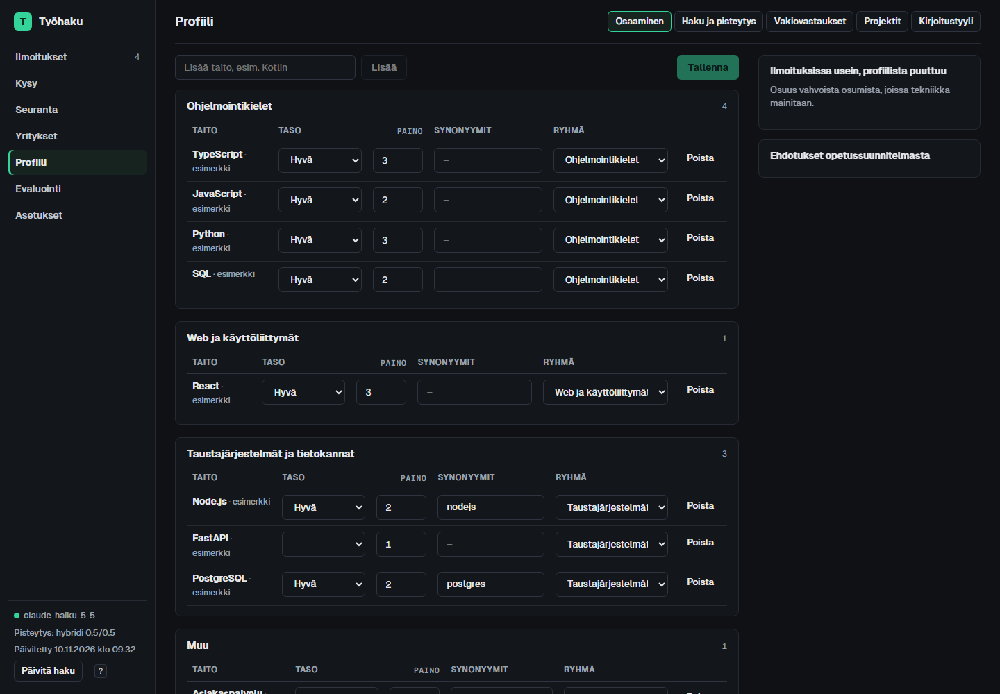

# jobhunter

> **In English:** a personal job search assistant for the Finnish job market. It collects postings
> (Duunitori sitemap, Kuntarekry), ranks them with keyword + semantic (RAG, `BAAI/bge-m3`, sqlite-vec)
> + LLM fit scoring, and evaluates the ranking against hand-labelled data (P@10, NDCG@10). For applying,
> it tailors a one-page CV through a multi-agent review panel (tailor, fact checker with veto, AI-screening
> simulator, recruiter, tech interviewer, hiring manager), writes application answers in the applicant's own
> learned style, and fills portal forms via a browser extension. The core rule is that nothing is invented:
> every claim is checked deterministically against the CV, and unsupported ones are flagged or rejected.
> Python (FastAPI) + React/TypeScript, local models via Ollama or the Claude API. ~200 tests.
> Documentation is in Finnish; details in [docs/TEKNINEN.md](docs/TEKNINEN.md).

Henkilökohtainen työnhakuavustaja: se etsii sopivat ilmoitukset, räätälöi CV:n jokaiseen paikkaan ja auttaa
täyttämään hakemukset, mutta ei keksi mitään eikä lähetä mitään puolestasi.

## Mitä se tekee

- **Haku:** koko Suomen ilmoitukset Duunitorin sivukartasta ja Kuntarekrystä. Otsikkosuodatin lukee vain sopivat.
- **Pisteytys:** avainsanat, semanttinen vastaavuus CV:hen ja kielimallin sopivuusarvio. Alue, taso ja etätyö painotetaan profiilin mukaan.
- **Räätälöity CV:** valitsee ja järjestää CV:si kohdat ilmoitukseen ja sovittaa yhdelle sivulle. Arviointipaneelissa viisi arvioijaa, joista faktantarkistajalla on veto-oikeus ja AI-seuloja simuloi rekrytointijärjestelmän esikarsintaa. Jokainen versio arkistoidaan PDF:nä.
- **Hakemukset:** vastaukset portaalien kysymyksiin ja saatekirje omalla kirjoitustyylilläsi, joka opitaan muokkauksistasi. Ilmoituksen omat hakuohjeet (esim. "kerro yhdestä projektista") noudatetaan.
- **Selainlaajennus:** ehdotus jokaisen lomakekentän viereen. Lomakkeen kysymykset jaetaan niin, ettei sama projekti toistu joka kentässä.
- **Seuranta:** hakemusten tilat, muistutukset ja vertailu siitä, millä CV:llä on saatu vastauksia.
- **Projektiskanneri:** löytää omista git-repoistasi projekteja, joita CV:ssä ei vielä ole, ja ehdottaa niitä hyväksyttäväksi.

## Periaatteet

- **Mitään ei keksitä.** Taidot, projektit, luvut ja väitteet tulevat vain CV:stä. Jokainen kirjoitettu lause tarkistetaan koodissa CV:tä vasten, ja lähteettömät liputetaan tai hylätään. Asiat, jotka vain sinä tiedät, jäävät kohdiksi `[Täytä itse]`.
- **Mitään ei lähetetä automaattisesti.** Laajennus ehdottaa, sinä kopioit ja lähetät.
- **Palkkatoive jätetään aina sinulle.**
- **Oma data pysyy koneellasi.** Kaikki henkilökohtainen on yhdessä kansiossa, joka ei ole versionhallinnassa.

## Pika-aloitus

```powershell
git clone https://github.com/EliasKarj/jobhunter.git
cd jobhunter
pip install -r requirements-rag.txt
copy .env.example .env               # kielimalli: Ollama (oletus) tai Claude API
mkdir data; notepad data\cv.md       # oma CV Markdownina (## Profile, ## Projects, ### Projektin nimi – kuvaus)
cd frontend; npm install; npm run build; cd ..
python webapp.py                     # http://127.0.0.1:8765
```

Kokeile ilman omaa dataa: `python webapp.py --demo` käyttää keksittyä esimerkkihenkilöä (`examples/`) ja esimerkki-ilmoituksia omassa kansiossaan `demo-data/`, ilman verkkoa.

**Oma data** on kansiossa `data/` (CV, profiili, osaaminen, hakemukset, CV-arkisto, välimuisti, varmuuskopiot). Kansion voi siirtää repon ulkopuolelle: `JOBHUNTER_DATA=C:\polku` `.env`-tiedostossa. Ensimmäisellä käynnistyksellä hakuasetukset kopioidaan esimerkkiprofiilista, ja niitä muokataan sovelluksen Profiili-sivulla.

**Taustakäyttö:** `install_autostart.ps1` käynnistää sovelluksen Windowsiin kirjauduttaessa. Puhelimesta käyttö onnistuu Tailscalen kautta (ks. [tekninen dokumentaatio](docs/TEKNINEN.md#etäkäyttö-puhelimella-tailscale)).

## Kielimalli

| | Paikallinen (oletus) | Claude API |
|---|---|---|
| Asetus | `LLM_PROVIDER=ollama`, `OLLAMA_MODEL=gemma3:12b` | `LLM_PROVIDER=claude`, `ANTHROPIC_API_KEY=…` |
| Tietosuoja | kaikki pysyy koneella | CV ja ilmoitukset lähetetään Anthropicille ([mitä lähtee](docs/TEKNINEN.md#mitä-claudelle-lähtee)) |
| Laatu ja nopeus | toimii, hitaampi, heikompi suomi | nopea, selvästi parempi kirjoitus |

Claudella suositus on halpa malli pisteytykseen ja arvioijiin ja parempi malli kirjoittamiseen:

```
CLAUDE_MODEL=claude-haiku-5-5            # pisteytys ja paneelin arvioijat
CLAUDE_MODEL_WRITING=claude-sonnet-5-5   # CV:n räätälöinti, vastaukset, saatekirje
```

Tällä jaolla paneeliajo maksaa noin 0,05 $, hakemusvastaus muutamia senttejä ja päivittäinen pisteytys alle dollarin kuukaudessa. Asetukset voi vaihtaa myös sovelluksen Asetukset-sivulla.

## Kuvia

Kuvat on otettu demotilassa keksityllä esimerkkihenkilöllä.



| | |
|---|---|
|  |  |
|  |  |

## Käyttö

| Sivu | Mitä siellä tehdään |
|---|---|
| Ilmoitukset | Pisteytetty lista, suodattimet ja haku. Näppäimet <kbd>j</kbd>/<kbd>k</kbd>, <kbd>Enter</kbd>, <kbd>?</kbd> ohje. |
| Ilmoitus | Teksti ja sopivuusselitys viitteineen. **Räätälöi CV** (<kbd>h</kbd>) avaa alkuperäisen ilmoituksen uuteen välilehteen ja tekee CV:n sillä välin. |
| Räätälöity CV | Paneelin arvio, seulontatulos, muokkaus suoraan paperilla ja PDF. |
| Kysy | Kysymykset ilmoituksista, vastaukset lähdeviitteineen. |
| Seuranta | Hakemusten tilat, muistutukset, kalenterivienti ja Mikä toimii -vertailu. |
| Profiili | Osaaminen, hakuasetukset, vakiovastaukset, projektiehdotukset ja kirjoitustyyli. |

**Selainlaajennus** (`extension/`): lataa kansio Chromeen kohdasta `chrome://extensions` → Lataa pakkaamaton, ja aseta avain sovelluksen Asetukset-sivulta. Laajennuksen kuvake hakemussivulla avaa ehdotukset kenttien viereen.

**Komentorivi:** `python -m rag chat "…"`, `python -m rag package <ilmoituksen URL>`, `python -m rag evaluate` (ks. [tekninen dokumentaatio](docs/TEKNINEN.md#ajo-ohjeet-kielimallit)).

## Rakenne

| Kansio | Sisältö |
|---|---|
| `jobhunter.py` | Ilmoitusten haku ja avainsanapisteytys |
| `rag/` | Semanttinen haku, kielimallit, CV:n räätälöinti ja paneeli, hakemukset, väitteiden tarkistus |
| `server/` | FastAPI-backend: seuranta, luonnokset, CV-arkisto ja PDF, laajennuksen rajapinta |
| `frontend/` | Käyttöliittymä (Vite, React, TypeScript) |
| `extension/` | Selainlaajennus |
| `examples/` | Keksitty esimerkkihenkilö testeille ja demolle |
| `tests/` | Testit (`pytest`) |
| `docs/TEKNINEN.md` | Arkkitehtuuri, valinnat ja perustelut, mittaukset |

## Testit ja evaluointi

```powershell
python -m pytest -q          # 197 testiä, eivät tee API-kutsuja eivätkä käytä omaa dataa
```

Rankingia on mitattu 89 käsin merkityllä ilmoituksella. Kärjen osuvuus (NDCG@10) oli avainsanoilla 0,66, hybridillä
0,69 ja yhdistelmällä, jossa on mukana kielimallin sopivuusarvio, 0,81 (AUC 0,84). Menetelmä, varaukset ja muut
mittaukset ovat [teknisessä dokumentaatiossa](docs/TEKNINEN.md#evaluointi).
